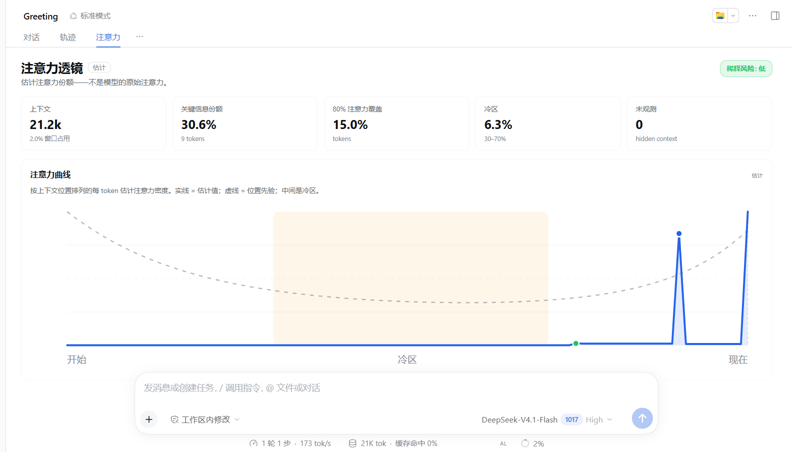
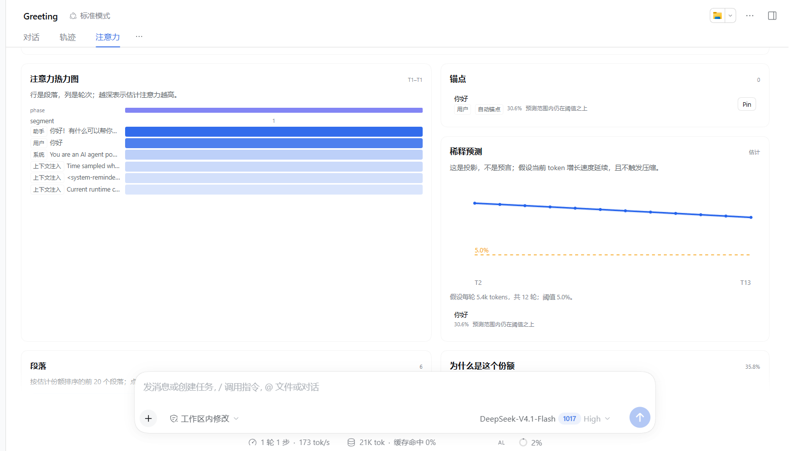

# Attention Lens / 注意力透镜

> 在上下文被稀释之前，看见注意力的去向。

Attention Lens 是一个 [DeepSeek Harness](https://github.com/deepseek-ai/deepseek-harness) 插件。它估计一次长会话里，模型的注意力预算如何分布在上下文窗口上：U 型注意力曲线、segment × turn 热力图、可 Pin 的锚点、稀释预测，以及每个段落的因子拆解。

**重要：模型 API 不返回注意力权重。** Attention Lens 是一个显式、可配置的**估计模型**——位置先验 + 内容显著性 + 词面相关性 + 年龄 + 锚点——不是对模型内部注意力的测量。把数字当作上下文工程信号，而不是测量值。详见 [METHODOLOGY.md](METHODOLOGY.md)。



## 为什么

长上下文不是均匀使用的。模型通常更关注开头和结尾，中间的“lost in the middle”区域容易被忽略；随着新轮次堆叠，旧事实的相对权重会被稀释。在 agent 会话里，这表现为：原始需求明明还在上下文里，模型却像“忘了”。

多数上下文工具展示的是 token 组成。Attention Lens 问的是另一个问题：**有限的注意力预算去了哪里，接下来的几轮会怎么改变它？**

## 功能

- **注意力曲线** — 按上下文位置显示每 token 的估计注意力密度；虚线是位置先验，阴影是冷区。
- **Segment × turn 热力图** — 看着某个需求变冷、工具输出变热。
- **稀释预测** — 预测接下来 N 轮，并给每个锚点一个倒计时：`还有 6 轮跌破 5%`。
- **锚点** — Pin 原始需求、设计决策或约束，追踪它的份额。没有 Pin 时，第一条真实用户消息会自动成为锚点。
- **可解释份额** — 点任意段落，查看位置、类型、相关性、显著性、年龄和 Pin 因子。
- **段落语义** — runtime context、时间快照、skill catalog 归类为 `context`，而不是用户意图，避免基础设施挤占真正的请求。
- **输入框迷你曲线** — composer dock 里的 `AL` sparkline。
- **中英双语** — 跟随宿主 locale。
- **纯本地** — 不联网、不埋点、不修改 prompt 或会话事件。



## 安装

目标版本：DeepSeek Harness `0.2.1-rc.3`。

从 npm 安装（发布后）：

```bash
dsh plugin --profile <profile> add dsh-attention-lens
```

从本地目录安装：

```bash
dsh plugin --profile <profile> add link:/absolute/path/to/dsh-attention-lens
```

DSH Desktop 的 profile 由 Electron 应用独占管理，CLI 会拒绝修改。Desktop 用户请通过 **设置 → 插件**（或 `plugin_manager` 工具）安装。

安装后打开一个会话，在“对话 / 轨迹”旁边选择 **注意力** 标签。当会话里有上下文时，composer dock 会出现 `AL` 迷你曲线。

## 使用

1. 打开一个有若干轮、至少一次工具调用的会话。
2. 进入 **注意力**。
3. Pin 你最在意的需求或约束。锚点卡会显示估计份额和预测倒计时。
4. 在 **设置 → 注意力透镜** 里调整预设、阈值和预测轮数。
5. 用曲线和热力图决定：重述、压缩、重排，还是拆会话。

所有数字都是估计值。UI 会明确标注，并展示每个份额的因子。

## 工作原理

```text
session events
     │
     ▼
宿主投影（attentionLens）
  surface 段落 · token 估计 · 工具 · usage · 上下文窗口
     │  wire.view
     ▼
客户端评分
  位置先验 × 类型 × 相关性 × 显著性 × 年龄 × 锚点
     │
     ├── 曲线 / 热力图 / 锚点
     ├── 稀释预测
     └── 因子拆解
```

- **宿主半**把已提交的会话事件折叠成模型可见的段落。不调用模型、不改 prompt、不追加会话事件。
- **客户端半**对这些段落评分、画图、把锚点和设置存进 `localStorage`，并模拟未来轮次。
- token 数优先来自 `ctx.tokenMeter.estimateMessage()`，不可用时使用对 CJK 更友好的 fallback；无精确 tokenizer 时标为近似。
- 最新 provider prompt 大小与已观测段落的差额会进入 `unobserved` 桶，避免假装看见了隐藏的 system/tool 内容。

公式、默认权重、指标定义和局限见 [METHODOLOGY.md](METHODOLOGY.md)。

## 隐私

- 所有计算都在本机 DSH 进程和浏览器里完成。
- 不发送会话内容到任何地方。
- 锚点和设置保存在本浏览器 `localStorage`。
- 宿主投影只向客户端传短预览和关键词袋，不传完整工具输出。

## 局限

- **这不是原始注意力。** 没有 API 暴露 attention matrix、KV cache 或每层权重；本插件是一个透明的估计模型。
- 位置偏置因模型和路由而异；默认值来自长上下文研究的先验，不是 DeepSeek 的实测曲线。
- 除非宿主 token meter 提供，token 数是近似值。
- 组装后的 system prompt 和 tool schema 可能部分不可见；这些 token 会进入 `unobserved` 桶。
- compaction 边界从事件重建；边界不可知时退化为近似。
- DeepSeek Harness 仍是 developer preview。插件只依赖稳定 seam（session projection、slots、locale），并声明 `engines.dsh`。

## 开发

```bash
npm install
npm test
```

插件是纯 JavaScript：宿主是 ESM（`.mjs`），浏览器半是 classic script，兼容 DSH client module loader。没有构建步骤。

在隔离 profile 里试本地目录：

```bash
dsh --profile attention-dev --from-default-profile web --dump-config
dsh plugin --profile attention-dev add link:/absolute/path/to/dsh-attention-lens
dsh --profile attention-dev
```

第二条创建基于 web 的测试 profile；第三条启动它。

## 路线图

- **0.2** — what-if lab（Pin / Compact / Reorder / Split 对比）、锚点提醒、compaction 集成。
- **0.3** — calibration lab：needle probe + 拟合 model profile。
- **0.4** — 可选本地实测注意力模式（开源模型），仅作对比。
- **1.0** — attention-preserving compaction 和项目级 context 健康报告。

## License

MIT，见 [LICENSE](LICENSE)。
